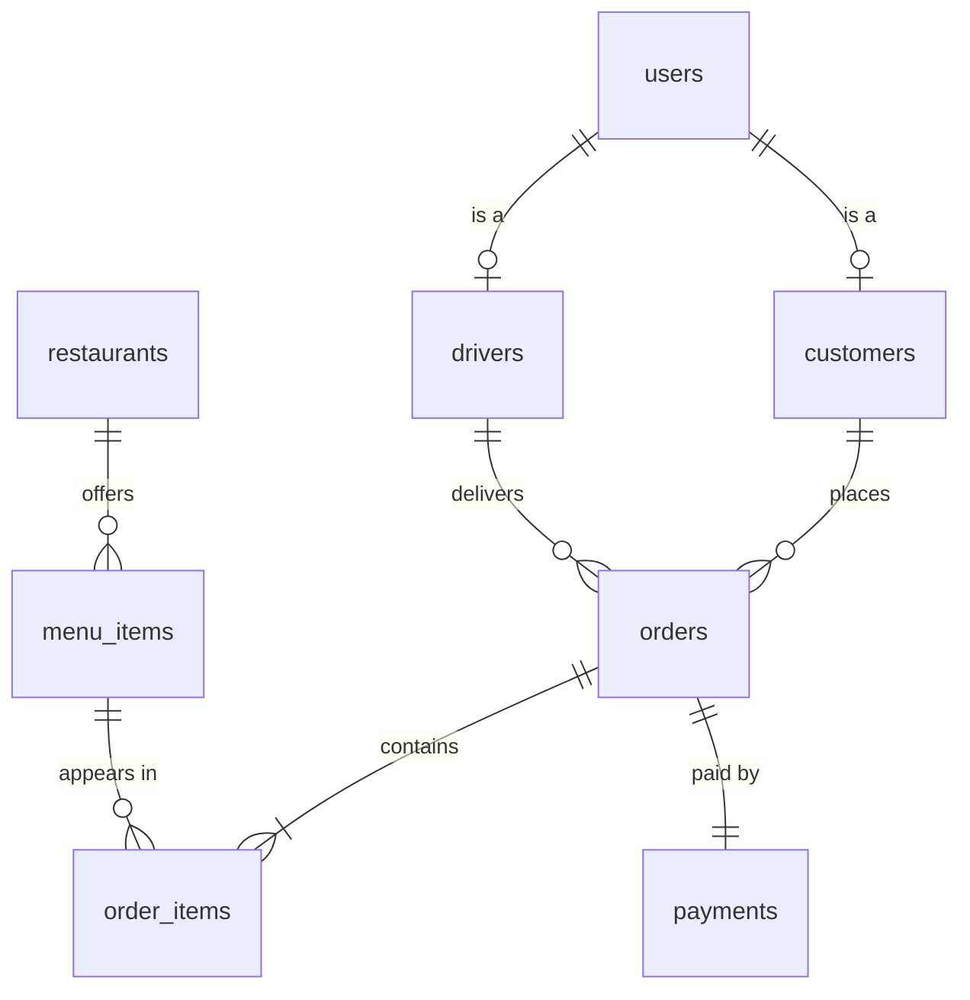

# Talabat FX 💗

A desktop food-ordering app built with **JavaFX** and **MySQL**. Browse restaurants, fill up a cart, check out, and get a delivery driver assigned to your order.

> A student project inspired by Talabat. It is not affiliated with or endorsed by Talabat.

## Features

- **Restaurants:** browse every restaurant in the database, each with its own logo.
- **Menus:** see each restaurant's dishes with photos and prices, and add them to your cart.
- **Cart:** the cart holds items from one restaurant at a time, and the button shows a live item count.
- **Checkout:** enter your name, email and delivery address (all checked before submitting) and pay by cash or card.
- **Delivery:** a random driver is assigned to every order.
- **Reliable orders:** the customer, order, items and payment are saved in a single database transaction, so a failed checkout never leaves a half-saved order behind.
- **No secrets in code:** database credentials come from a git-ignored `db.properties` file or from environment variables.

## Tech stack

| Layer     | Technology                     |
|-----------|--------------------------------|
| Language  | Java 25                        |
| UI        | JavaFX 25 (styled with CSS)    |
| Database  | MySQL 8 via JDBC (Connector/J) |
| Build     | Maven                          |

## Getting started

### Prerequisites

- [JDK 25](https://adoptium.net/) or newer
- [Maven 3.9+](https://maven.apache.org/download.cgi)
- [MySQL 8](https://dev.mysql.com/downloads/mysql/) running locally

You don't need to download JavaFX or the MySQL driver yourself, because Maven fetches both.

### 1. Clone the repository

```bash
git clone https://github.com/aytensultan1101/Talabat-FX.git
cd Talabat-FX
```

### 2. Create the database

This creates `talabat_db` with all tables, plus sample restaurants, menu items and drivers:

```bash
mysql -u root -p < database/schema.sql
```

### 3. Configure the connection

Copy the example config and put your MySQL password in it:

```bash
cp db.properties.example db.properties     # Windows: copy db.properties.example db.properties
```

```properties
db.url=jdbc:mysql://localhost:3306/talabat_db?useSSL=false&allowPublicKeyRetrieval=true&serverTimezone=UTC
db.user=root
db.password=your-password-here
```

`db.properties` is listed in `.gitignore`, so your password stays on your machine.

### 4. Run the app

```bash
mvn javafx:run
```

## Running from an IDE

The project is a standard Maven project, so any Java IDE can import it from `pom.xml`.

- **IntelliJ IDEA:** *File → Open* the project folder. To run it, open the Maven tool window and run *Plugins → javafx → javafx:run*.
- **Eclipse:** *File → Import → Maven → Existing Maven Projects*. To run it, right-click the project and choose *Run As → Maven build…*, then enter the goal `javafx:run`.
- **VS Code:** install the *Extension Pack for Java*, then run `javafx:run` from the Maven sidebar.

> Running `MainApp` directly with the IDE's ▶ button fails with *"JavaFX runtime components are missing"*, because JavaFX has to be on the module path. Use `javafx:run`, which sets that up for you.

## Configuration

Settings are resolved in this order (first match wins):

| Setting  | Environment variable  | `db.properties` key | Default                                     |
|----------|-----------------------|---------------------|---------------------------------------------|
| JDBC URL | `TALABAT_DB_URL`      | `db.url`            | `jdbc:mysql://localhost:3306/talabat_db?…`  |
| User     | `TALABAT_DB_USER`     | `db.user`           | `root`                                      |
| Password | `TALABAT_DB_PASSWORD` | `db.password`       | *(empty)*                                   |

`db.properties` is read from the working directory, which is the project root when you use `mvn javafx:run`.

## Database



| Table         | Purpose                                                          |
|---------------|------------------------------------------------------------------|
| `users`       | Everyone in the system, with `role` set to `customer` or `driver` |
| `customers`   | Delivery address for a customer user                             |
| `drivers`     | Users who can be assigned to deliver orders                      |
| `restaurants` | Restaurants shown on the home screen                             |
| `menu_items`  | Dishes and their prices, per restaurant                          |
| `orders`      | One row per checkout: customer, driver, date, total              |
| `order_items` | Items and quantities in each order                               |
| `payments`    | Payment method (`Cash` / `Card`) for each order                  |

The full definitions are in [`database/schema.sql`](database/schema.sql).

### Adding restaurants and dishes

Insert rows into `restaurants` and `menu_items`. The app picks images by **keyword in the name**. For example, a restaurant whose name contains "toto" gets `toto.png`, and a dish containing "pizza" gets `pizza.png`. To add a new image:

1. Drop the PNG into `src/resources/restaurants/` or `src/resources/menu/`.
2. Add a matching keyword to `getRestaurantImage` or `getMenuImage` in [`MainApp.java`](src/MainApp.java).

## Project structure

```
Talabat-FX/
├── database/
│   └── schema.sql             # Creates talabat_db and loads sample data
├── src/
│   ├── MainApp.java           # JavaFX UI: restaurants → menu → cart and checkout
│   ├── Cart.java              # In-memory cart (one restaurant at a time)
│   ├── CheckoutService.java   # Places an order in a single transaction
│   ├── DBConnection.java      # Loads settings and opens JDBC connections
│   ├── MenuItem.java          # Menu item model
│   ├── *DAO.java              # One data-access class per table
│   └── resources/
│       ├── style.css          # App theme
│       ├── menu/              # Dish photos
│       └── restaurants/       # Restaurant logos
├── db.properties.example      # Template for your local db.properties
└── pom.xml                    # Maven build (JavaFX + MySQL Connector/J)
```

## Troubleshooting

| Error                                          | Fix                                                                                   |
|------------------------------------------------|---------------------------------------------------------------------------------------|
| *Couldn't reach the database* (in the app)     | Make sure MySQL is running, then check `db.properties`. The console shows the full error. |
| `Communications link failure`                  | MySQL isn't running, or the host/port in `db.url` is wrong.                           |
| `Access denied for user 'root'@'localhost'`    | Wrong user or password in `db.properties`.                                            |
| `Unknown database 'talabat_db'`                | Run `database/schema.sql` first.                                                      |
| `Public Key Retrieval is not allowed`          | Add `allowPublicKeyRetrieval=true` to `db.url`, as the example does.                  |
| `No drivers available to deliver the order`    | Add rows to `users` (role `driver`) and `drivers`. The schema script seeds three.     |
| `JavaFX runtime components are missing`        | Launch with `mvn javafx:run` instead of running `MainApp` directly.                   |
